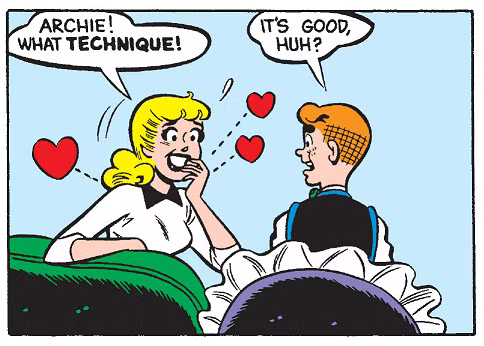

# Bevy Archie - Rust / Bevy Controller Support Module

[](https://opensource.org/licenses/MIT)
[](https://opensource.org/licenses/Apache-2.0)
[](https://www.rust-lang.org)
[](https://bevyengine.org)
[](https://bevy.org/learn/quick-start/plugin-development/#main-branch-tracking)
[](https://crates.io/crates/bevy_archie)
[](https://docs.rs/bevy_archie)



> **Branch policy:** `main` tracks **Bevy 0.20.x**. The maintenance branches are [`bevy-0.19`](https://github.com/greysquirr3l/bevy-archie/tree/bevy-0.19) for **Bevy 0.19.x** and [`bevy-0.18`](https://github.com/greysquirr3l/bevy-archie/tree/bevy-0.18) for **Bevy 0.18.x**. Bevy 0.17 support is no longer maintained; the final 0.1.x release remains on [crates.io](https://crates.io/crates/bevy_archie/0.1.4) for existing consumers.

A comprehensive game controller support module for the Bevy engine, inspired by the RenPy Controller GUI project.

## Controller Support Matrix

| Controller           | Gyroscope | Touchpad | Adaptive Triggers | Rumble | Layout      |
|----------------------|:---------:|:--------:|:-----------------:|:------:|-------------|
| Xbox 360             | 🔴        | 🔴       | 🔴                | ✅     | Xbox        |
| Xbox One             | 🔴        | 🔴       | 🔴                | ✅     | Xbox        |
| Xbox Series X\|S     | 🔴        | 🔴       | 🔴                | ✅     | Xbox        |
| PlayStation 3        | ✅        | 🔴       | 🔴                | ✅     | PlayStation |
| PlayStation 4        | ✅        | ✅       | 🔴                | ✅     | PlayStation |
| PlayStation 5        | ✅        | ✅       | ✅                | ✅     | PlayStation |
| Switch Pro           | ✅        | 🔴       | 🔴                | ✅     | Nintendo    |
| Switch 2 Pro         | ✅        | 🔴       | 🔴                | ✅     | Nintendo    |
| Switch 2 GameCube    | ✅        | 🔴       | 🔴                | ✅     | Nintendo    |
| Switch Joy-Con       | ✅        | 🔴       | 🔴                | ✅     | Nintendo    |
| Steam Controller     | ✅        | ✅       | 🔴                | ✅     | Xbox        |
| Stadia               | ✅        | 🔴       | 🔴                | ✅     | Xbox        |
| Amazon Luna          | 🔴        | 🔴       | 🔴                | ✅     | Xbox        |
| 8BitDo M30           | 🔴        | 🔴       | 🔴                | ✅     | Nintendo    |
| 8BitDo SN30 Pro      | 🔴        | 🔴       | 🔴                | ✅     | Nintendo    |
| HORI Fighting Cmd    | 🔴        | 🔴       | 🔴                | ✅     | PlayStation |
| Generic              | 🔶        | 🔶       | 🔴                | ✅     | Xbox        |

> **Legend**: ✅ Supported | 🔴 Hardware limitation | 🔶 Unknown (varies by device)
>
> **Note**: Gyroscope, touchpad, and adaptive triggers require platform-specific implementations. See [Advanced Features Guide](docs/ADVANCED_FEATURES.md) for details.

## Version Compatibility

| bevy | bevy_archie                                                                       |
|------|-----------------------------------------------------------------------------------|
| 0.20 | 0.5.x (`main`)                                                                    |
| 0.19 | [0.3.x (`bevy-0.19`)](https://github.com/greysquirr3l/bevy-archie/tree/bevy-0.19) |
| 0.18 | [0.2.x (`bevy-0.18`)](https://github.com/greysquirr3l/bevy-archie/tree/bevy-0.18) |
| 0.17 | 0.1.x (final, on [crates.io](https://crates.io/crates/bevy_archie/versions))      |

> `main` is Bevy 0.20.x and requires Rust 1.97.1+. Bevy 0.17 is no longer maintained; the `bevy-0.17` branch has been retired.

## Features

### Core Input System

- **Input Device Detection**: Automatically detect and switch between mouse, keyboard, and gamepad input
- **Input Action Mapping**: Abstract input actions with customizable bindings for gamepad, keyboard, and mouse
- **Action State Tracking**: Query pressed, just_pressed, just_released states and analog values for any action
- **Per-Stick Settings**: Independent sensitivity and inversion for left/right analog sticks
- **Deadzone Configuration**: Configurable stick deadzones with per-stick customization

### Controller Support

- **Controller Icon System**: Asset-agnostic icon mapping system that adapts to controller type (Xbox, PlayStation, Nintendo, Steam, Stadia, Generic). Bring your own icon assets or use any compatible pack.
- **Controller Profiles**: Automatic detection and profile loading based on vendor/product IDs
- **Multi-controller Support**: Handle multiple connected controllers with player assignment
- **Controller Layout Detection**: Auto-detect and adapt UI to controller type

### Advanced Input Features

- **Haptic Feedback**: Rumble and vibration patterns (Constant, Pulse, Explosion, DamageTap, HeavyImpact, Engine, Heartbeat) - fully implemented
- **Input Buffering**: Record and analyze input sequences for fighting game-style combo detection
- **Action Modifiers**: Detect Tap, Hold, DoubleTap, LongPress, and Released events on actions
- **Button Chords**: Detect simultaneous button combinations with configurable clash resolution
- **Virtual Input Composites**: Combine buttons into virtual axes (`VirtualAxis`, `VirtualDPad`, `VirtualDPad3D`)
- **Conditional Bindings**: Context-aware actions that activate based on game state or custom conditions
- **Input State Machine**: Define state machines driven by input actions with automatic transitions
- **Gyroscope Support**: Motion controls for PS4/PS5/Switch/Stadia/Steam controllers - complete gesture detection and data structures, needs hardware driver integration (HID/SDL2). See [ps5_dualsense_motion.rs](examples/ps5_dualsense_motion.rs) and [switch_pro_gyro.rs](examples/switch_pro_gyro.rs)
- **Touchpad Support**: PS4/PS5/Steam touchpad input with multi-touch and gesture detection (swipe, pinch, tap) - complete gesture detection and data structures, needs hardware driver integration (HID/SDL2). See [ps5_dualsense_motion.rs](examples/ps5_dualsense_motion.rs) and [steam_touchpad.rs](examples/steam_touchpad.rs)

### Multiplayer

- **Player Assignment**: Automatic or manual controller-to-player assignment (up to 4 players)
- **Controller Ownership**: Track which player owns which controller
- **Hot-swapping**: Handle controller disconnection and reassignment

### UI & Configuration

- **Controller Remapping**: Allow players to remap controller buttons at runtime
- **Virtual Keyboard**: On-screen keyboard for controller-friendly text input
- **Virtual Cursor**: Gamepad-controlled cursor for mouse-based UI navigation
- **Configuration Persistence**: Save and load controller settings with Bevy's `SettingsPlugin`

### Developer Tools

- **Input Debugging**: Visualize input states, history, and analog values
- **Input Recording**: Record input sequences for testing and replay
- **Input Playback**: Play back recorded inputs for automated testing
- **Input Mocking**: `MockInput` and `MockInputPlugin` for unit testing input-dependent systems
- **Build Helpers**: Generate icon manifests and organize controller assets at build time

### Mobile & Touch

- **Touch Joystick**: Virtual on-screen joysticks for mobile platforms with fixed or floating modes

### Networking

- **Input Synchronization**: `ActionDiff` and `ActionDiffBuffer` for efficient network input sync with rollback support

## Supported Controllers

- **Xbox** - Xbox 360, Xbox One, Xbox Series X|S controllers
- **PlayStation** - PS3, PS4, PS5 (DualShock 3, DualShock 4, and DualSense)
- **Nintendo** - Switch Pro Controller, Switch 2 Pro, Switch 2 GameCube, Joy-Cons
- **Steam** - Steam Controller, Steam Deck
- **Stadia** - Google Stadia Controller (Bluetooth mode)
- **Amazon Luna** - Amazon Luna Controller (Xbox-style layout)
- **8BitDo** - M30, SN30 Pro
- **HORI** - Fighting Commander
- **Generic** - Any other standard gamepad

**Note**: Stadia controllers must be switched to Bluetooth mode (a permanent one-time operation that was available until Dec 31, 2025). In Bluetooth mode, they function as standard Xbox-style gamepads.

## Installation

Add to your `Cargo.toml`:

```toml
[dependencies]
bevy_archie = "0.4"
# Or with specific features:
bevy_archie = { version = "0.4", features = ["full"] }
# Or from a local checkout:
# bevy_archie = { path = "path/to/bevy-archie" }
```

### Cargo Features

| Feature            | Description                                                           |
| ------------------ | --------------------------------------------------------------------- |
| `icons`            | Auto-update icon displays when the detected controller layout changes |
| `virtual_keyboard` | On-screen keyboard for controller-driven text input                   |
| `remapping`        | Runtime controller remapping (UI + `RemapButton` component)           |
| `motion-backends`  | Motion backend abstractions - required by any motion backend          |
| `dualsense`        | DualSense (PS5) support over HID - implies `motion-backends`          |
| `full`             | Enables `icons`, `virtual_keyboard`, and `remapping`                  |

No features are enabled by default; the core input, detection, icon, and configuration
APIs are always available.

### Library Size

| Configuration    | Pre-link (.rlib) | Final Binary Impact |
| ---------------- | ---------------- | ------------------- |
| Default features | ~7.3 MB          | ~200-400 KB         |
| `full` feature   | ~9.8 MB          | ~300-500 KB         |

The `.rlib` size includes Rust metadata and monomorphization templates. After LTO and dead code elimination, bevy_archie adds roughly **0.5-1%** overhead on top of a typical Bevy application (~50-80 MB).

The `.rlib` figures above are measured from `cargo build --release --lib` on `main`
(Bevy 0.20, Rust 1.97.1). Enabling `motion-backends` and `dualsense` on top of `full`
adds only ~60 KB.

## Quick Start

```rust
use bevy::prelude::*;
use bevy_archie::prelude::*;

fn main() {
    App::new()
        .add_plugins(DefaultPlugins)
        .add_plugins(ControllerPlugin::default())
        .add_systems(Startup, setup)
        .add_systems(Update, handle_input)
        .run();
}

fn setup(mut commands: Commands) {
    commands.spawn(Camera2d);
}

fn handle_input(
    input_state: Res<InputDeviceState>,
    actions: Res<ActionState>,
) {
    // Check which input device is active
    match input_state.active_device {
        InputDevice::Mouse => { /* Mouse logic */ }
        InputDevice::Keyboard => { /* Keyboard logic */ }
        InputDevice::Gamepad(_) => { /* Controller logic */ }
    }

    // Check action states
    if actions.just_pressed(GameAction::Confirm) {
        println!("Confirm pressed!");
    }
}
```

## Action System

Define your game actions and bind them to controller buttons:

```rust
use bevy::prelude::*;
use bevy_archie::actions::AxisDirection;
use bevy_archie::prelude::*;

// Actions are predefined, but you can extend with custom actions
fn setup_actions(mut action_map: ResMut<ActionMap>) {
    // Start from a clean slate for an action if needed
    action_map.clear_bindings(GameAction::Up);

    // Rebind an action to a gamepad button
    action_map.bind_gamepad(GameAction::Confirm, GamepadButton::South);
    action_map.bind_gamepad(GameAction::Cancel, GamepadButton::East);

    // Add keyboard bindings
    action_map.bind_key(GameAction::Confirm, KeyCode::Enter);
    action_map.bind_key(GameAction::Cancel, KeyCode::Escape);

    // Bind an analog axis (axis, direction, threshold)
    action_map.bind_axis(
        GameAction::Up,
        GamepadAxis::LeftStickY,
        AxisDirection::Positive,
        0.5,
    );
}
```

The default `ActionMap` already binds the face buttons, shoulder buttons, D-pad, and both
analog sticks, so rebinding is only needed when you want to deviate from the defaults.

## Controller Icons

**Note**: bevy-archie is asset-agnostic. You must provide your own icon assets or use a compatible icon pack like:

- [Mr. Breakfast's Free Prompts](https://mrbreakfastsdelight.itch.io/mr-breakfasts-free-prompts) (400+ icons, Xbox/PS/Switch/Steam Deck)
- [Kenney Input Prompts](https://kenney.nl/assets/input-prompts)
- Custom artwork

The icon system provides platform-aware filename generation and asset loading infrastructure. Point it to your icon directory:

```rust
use bevy::prelude::*;
use bevy_archie::prelude::*;

fn setup_icons(mut commands: Commands) {
    commands.insert_resource(
        ControllerIconAssets::new("assets/icons")  // Your icon directory
    );
}
```

Alternatively, set the base path once when adding the plugin:

```rust
app.add_plugins(ControllerPlugin::with_icon_path("assets/icons"));
```

Display controller-appropriate button icons in your UI:

```rust
use bevy::prelude::*;
use bevy_archie::icons::ButtonIcon;
use bevy_archie::prelude::*;

fn spawn_button_prompt(
    mut commands: Commands,
    mut icon_assets: ResMut<ControllerIconAssets>,
    config: Res<ControllerConfig>,
    asset_server: Res<AssetServer>,
) {
    let handle = icon_assets.get_icon(
        ButtonIcon::FaceDown,
        config.layout(),
        IconSize::Medium,
        &asset_server,
    );

    commands.spawn(ImageNode {
        image: handle,
        ..default()
    });
}
```

To look an icon up from a raw gamepad button instead, use `get_button_icon`:

```rust
let handle = icon_assets.get_button_icon(
    GamepadButton::South,
    config.layout(),
    IconSize::Medium,
    &asset_server,
);
```

### Auto-Updating Icons

Spawn a `ControllerIconDisplay` alongside an `ImageNode` and the icon swaps itself whenever the
detected controller layout changes. This requires the `icons` Cargo feature:

```rust
commands.spawn((
    ImageNode {
        ..default()
    },
    ControllerIconDisplay {
        icon: ButtonIcon::FaceDown,
        size: IconSize::Medium,
        auto_update: true,
    },
));
```

### Icon Naming Conventions

The system expects icons named according to platform conventions:

- **Xbox**: `xbox_a.png`, `xbox_b.png`, `xbox_x.png`, `xbox_y.png`, `xbox_lb.png`, `xbox_rb.png`, `xbox_lt.png`, `xbox_rt.png`, `xbox_menu.png`, `xbox_view.png`
- **PlayStation**: `ps_cross.png`, `ps_circle.png`, `ps_square.png`, `ps_triangle.png`, `ps_l1.png`, `ps_r1.png`, `ps_l2.png`, `ps_r2.png`, `ps_options.png`, `ps_share.png`
- **Nintendo**: `switch_b.png`, `switch_a.png`, `switch_y.png`, `switch_x.png`, `switch_l.png`, `switch_r.png`, `switch_zl.png`, `switch_zr.png`, `switch_plus.png`, `switch_minus.png`
- **Stadia**: `stadia_a.png`, `stadia_b.png`, `stadia_x.png`, `stadia_y.png`, `stadia_l1.png`, `stadia_r1.png`, `stadia_l2.png`, `stadia_r2.png`
- **Generic**: `left_stick.png`, `right_stick.png`, `left_stick_press.png`, `right_stick_press.png`, `dpad.png`, `dpad_up.png`, `dpad_down.png`, `dpad_left.png`, `dpad_right.png`, `home.png`

Icon sizes are supported via suffixes: `xbox_a_small.png` (32x32), `xbox_a.png` (48x48), `xbox_a_large.png` (64x64).

If your icon pack uses different naming, create a thin wrapper or use symbolic links to match the expected names.

## Remapping

Enable controller remapping in your settings menu. This requires the `remapping` Cargo feature:

```rust
use bevy::prelude::*;
use bevy_archie::prelude::*;

fn spawn_remap_ui(mut commands: Commands) {
    commands.spawn((
        RemapButton {
            action: GameAction::Confirm,
        },
        // ... UI components
    ));
}
```

## Configuration

```rust
use bevy_archie::prelude::*;

fn configure_controller(mut config: ResMut<ControllerConfig>) {
    // Stick deadzone (0.0 - 1.0)
    config.deadzone = 0.15;
    
    // Per-stick sensitivity multipliers
    config.left_stick_sensitivity = 1.0;
    config.right_stick_sensitivity = 1.5; // Faster cursor movement
    
    // Per-stick X-axis inversion
    config.invert_left_x = false;
    config.invert_right_x = true; // Inverted camera controls
    
    // Auto-detect controller layout
    config.auto_detect_layout = true;

    // Force a specific layout
    config.forced_layout = Some(ControllerLayout::PlayStation);
}
```

`config.layout()` returns the layout currently in effect — the forced layout if one is set,
otherwise the auto-detected one.

## Virtual Cursor

Enable gamepad-controlled cursor for mouse-based UI:

```rust
use bevy::prelude::*;
use bevy_archie::prelude::*;

fn setup(mut commands: Commands, asset_server: Res<AssetServer>) {
    // Spawn virtual cursor (automatically shown when gamepad active).
    // Returns the spawned entity if you want to track it yourself.
    let _cursor = bevy_archie::virtual_cursor::spawn_virtual_cursor(
        &mut commands,
        &asset_server,
        None, // Uses default cursor.png
    );
}

fn handle_clicks(mut click_events: MessageReader<VirtualCursorClick>) {
    for event in click_events.read() {
        println!("Cursor clicked at: {:?}", event.position);
    }
}
```

> **Note:** Bevy 0.20 renamed `EventReader`/`EventWriter` to `MessageReader`/`MessageWriter`.
> Use the message variants when targeting Bevy 0.20 and later.

## Configuration Persistence

`ControllerConfig` is a Bevy **`SettingsGroup`**, so it is persisted with Bevy's `SettingsPlugin`:

```rust
use std::time::Duration;

use bevy::prelude::*;
use bevy::settings::{SaveSettingsDeferred, SaveSettingsSync, SettingsPlugin};
use bevy_archie::prelude::*;

fn main() {
    App::new()
        .add_plugins(DefaultPlugins)
        .add_plugins(ControllerPlugin::default())
        // Loads ControllerConfig from disk and applies it over the defaults.
        .add_plugins(SettingsPlugin::new("com.example.mygame"))
        .add_systems(Update, save_config_on_change)
        .add_systems(Last, save_on_exit)
        .run();
}

/// Debounced save - the write is scheduled shortly after the last change.
fn save_config_on_change(config: Res<ControllerConfig>, mut commands: Commands) {
    if config.is_changed() && !config.is_added() {
        commands.queue(SaveSettingsDeferred(Duration::from_millis(250)));
    }
}

/// Immediate save on shutdown, so nothing is lost when the window is closed.
fn save_on_exit(mut commands: Commands) {
    commands.queue(SaveSettingsSync::IfChanged);
}
```

`ControllerPlugin::with_settings(app_id)` is a shorthand that adds the `SettingsPlugin` for you:

```rust
App::new()
    .add_plugins(DefaultPlugins)
    .add_plugins(ControllerPlugin::with_settings("com.example.mygame"))
    .run();
```

Settings are written as TOML to a platform-specific preferences directory:

- **Linux**: `~/.config/{app_id}/settings.toml`
- **macOS**: `~/Library/Preferences/{app_id}/settings.toml`
- **Windows**: `%LOCALAPPDATA%\{app_id}\settings.toml`

`ControllerConfig::current_layout` is runtime state and is not persisted; `forced_layout` is.

> **Deprecated:** the crate's own JSON helpers — `ControllerConfig::load_or_default`,
> `load_from_file`, `save_default`, `save_to_file`, and `default_config_path` — are deprecated
> and will be removed in 0.6.0. See the
> [migration recipe](docs/dev/0.4_TO_0.5_MIGRATION.md#controller-config-persistence--bevy-settingsplugin).

## Examples

Bevy-archie includes several examples to help you get started:

### Basic Examples

- **[basic_input.rs](examples/basic_input.rs)**: Simple input handling
- **[controller_icons.rs](examples/controller_icons.rs)**: Display controller-specific icons
- **[controller_database.rs](examples/controller_database.rs)**: Inspect the VID/PID controller detection database
- **[remapping.rs](examples/remapping.rs)**: Runtime button remapping *(requires the `remapping` feature)*
- **[virtual_cursor.rs](examples/virtual_cursor.rs)**: Gamepad-controlled cursor
- **[config_persistence.rs](examples/config_persistence.rs)**: Save/load settings

### Advanced Hardware Integration

These examples show how to integrate real hardware for gyro and touchpad:

- **[ps5_dualsense_motion.rs](examples/ps5_dualsense_motion.rs)**: DualSense gyro + touchpad via hidapi
  - Complete HID report parsing reference
  - Both USB and Bluetooth modes
  - Calibration and data injection patterns
  
- **[switch_pro_gyro.rs](examples/switch_pro_gyro.rs)**: Switch Pro Controller gyro via SDL2
  - Cross-platform gyro support
  - Alternative: Direct HID approach
  
- **[steam_touchpad.rs](examples/steam_touchpad.rs)**: Steam Deck/Steam Controller touchpad
  - Steam Input API integration (recommended)
  - Alternative: Direct HID for advanced users

Run examples with:

```bash
cargo run --example basic_input
cargo run --example remapping --features remapping
cargo run --example ps5_dualsense_motion --features motion-backends
```

## Supported Controller Layouts

- **Xbox**: Xbox 360, Xbox One, Xbox Series controllers
- **PlayStation**: DualShock 3/4, DualSense
- **Nintendo**: Switch Pro, Switch 2 Pro, Switch 2 GameCube, Joy-Con
- **Steam**: Steam Controller, Steam Deck
- **Stadia**: Google Stadia Controller (Bluetooth mode)
- **Amazon Luna**: Amazon Luna Controller (Xbox-style layout)
- **Generic**: Fallback for unrecognized controllers

## Documentation Map

For a faster overview, this README stays focused on setup and common workflows.
Deep dives are split into dedicated docs:

- [Advanced Features Guide](docs/ADVANCED_FEATURES.md)
- [API Reference Guide](docs/API_REFERENCE.md)
- [Hardware Integration Guide](docs/HARDWARE_INTEGRATION_GUIDE.md)
- [Joypad OS Quick Start](docs/JOYPAD_OS_QUICK_START.md) — controller-specific features and calibration constants
- [Joypad OS Implementation Summary](docs/JOYPAD_OS_IMPLEMENTATION_SUMMARY.md) — what was integrated from the Joypad OS hardware database
- [Joypad OS Integration Analysis](docs/JOYPAD_OS_INTEGRATION_ANALYSIS.md) — how firmware-level controller translation relates to this library
- [Joypad OS Attribution Guide](docs/JOYPAD_OS_ATTRIBUTION.md) — licensing notes for the Joypad OS derived data

## Testing

Quick commands:

```bash
cargo test --lib
cargo test
cargo test --all-features
```

Coverage is measured locally with [cargo-tarpaulin](https://github.com/xd009642/tarpaulin):

```bash
cargo install cargo-tarpaulin
cargo tarpaulin --all-features --out Html
# Report is written to target/coverage/tarpaulin-report.html
```

## Credits

Inspired by the [RenPy Controller GUI](https://feniksdev.com) by Feniks.

## License

Licensed under either of:

- Apache License, Version 2.0 ([LICENSE-APACHE_2.0](LICENSE-APACHE_2.0))
- MIT license ([LICENSE-MIT](LICENSE-MIT))

at your option.
